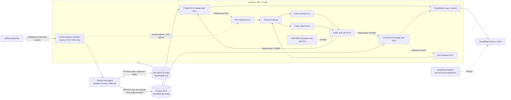

# YPP Fiber: AWS ECS Fargate + Jenkins + Terraform

This repository deploys the current `index.html` static demo as an nginx container. It does **not** implement the demo login, payments, forms, or customer data APIs; those screens explicitly simulate backend behavior. Do not collect customer information or process payments with this static build.

The Terraform provisions a multi-AZ VPC, ECR, an internet-facing HTTP ALB with WAF and access logs, private ECS Fargate tasks, autoscaling, CloudWatch/SNS monitoring, and a private Ubuntu 22.04 Jenkins controller. The application ALB has no ACM certificate and serves plaintext HTTP only. Do not send credentials, personal information, or payment data through it. Jenkins has no inbound security-group rules and is administered with SSM. Build/deploy jobs must run on a separate hardened Jenkins agent that has Docker and an AWS deployment role. A private Jenkins server is not directly reachable by GitHub webhooks; see [GitHub webhook ingress](#github-webhook-ingress).

## Current AWS deployment status

- Application: [http://ypp-fiber-prod-alb-1316212500.us-east-1.elb.amazonaws.com](http://ypp-fiber-prod-alb-1316212500.us-east-1.elb.amazonaws.com), serving HTTP only.
- ECS service is active with 2/2 tasks running and both ALB targets healthy. Active task definition: `ypp-fiber-prod-app:3`; deployed ECR tag: `sha-manual-20261116-v2`.
- GuardDuty is enabled in `us-east-1`; findings are routed through EventBridge to SNS topic `ypp-fiber-prod-alarms`. No SNS subscription is configured yet, so alarms/findings have no operator delivery destination. Set `alarm_email` and confirm its subscription.
- Jenkins EC2 was not provisioned: the AWS Organizations SCP explicitly denies `ec2:RunInstances`. An Organizations administrator must approve/adjust that policy before setting `provision_jenkins=true` and applying. Do not attempt to bypass the SCP.

## 1. Architecture



### Request and deployment flow

1. Client HTTP traffic reaches the ALB on port 80; WAF inspects requests. Traffic is unencrypted between client and ALB. Use only for a public, non-sensitive demo.
2. The ALB forwards only to healthy task IPs. Task security groups accept the app port only from the ALB security group.
3. ECS tasks have no public IP; NAT gateways provide outbound access for image pulls and updates.
4. GitHub triggers Jenkins through a deliberately controlled webhook ingress. Jenkins schedules tests/scans/build/deploy on an isolated agent using its instance role—never stored AWS access keys.
5. Terraform state is encrypted/versioned in S3, with DynamoDB state locking. ECS deployment circuit breaker is enabled.

## 2. Repository layout

```text
.
├── Dockerfile
├── Jenkinsfile
├── README.md
├── index.html
├── nginx.conf
├── sonar-project.properties
├── tests/test_site.py
└── terraform
    ├── bootstrap/                 # Encrypted state bucket + DynamoDB lock table
    ├── environments/prod/         # Production composition, backend, vars, outputs
    └── modules
        ├── alb/                   # HTTP ALB, target group, WAF, S3 access logs
        ├── ecr/                   # Immutable repository and image lifecycle
        ├── ecs/                   # Cluster, task/service, autoscaling, log group
        ├── iam/                   # Task and execution roles; secret read scope
        ├── jenkins/               # Private Ubuntu controller, SSM, CloudWatch logs
        ├── monitoring/            # Dashboard, alarms, optional SNS email topic
        ├── security/              # ALB and task security groups
        └── vpc/                   # VPC, public/private subnets, IGW, NAT, routes
```

Terraform module inputs are in each module's `variables.tf`; outputs are in `outputs.tf`. Production values belong in the ignored `prod.tfvars`/Jenkins config file and must not contain secret values—use Secrets Manager ARNs instead.

## 3. Prerequisites and AWS account preparation

Use an AWS account dedicated to this workload or an approved account/vending workflow. Confirm quotas for VPCs, Elastic IPs, NAT gateways, Fargate tasks, ALBs, WAF, and ECR. Decide the public DNS hostname, contact email for alarms, approved source CIDRs, and retention requirements.

### On macOS

```bash
brew install awscli terraform git
brew install --cask session-manager-plugin
aws configure sso
aws sso login --profile devsecops-admin
export AWS_PROFILE=devsecops-admin
export AWS_REGION=us-east-1
aws sts get-caller-identity
terraform version
```

Use SSO/temporary credentials for a human administrator. Do not put access keys in shell history, `.tfvars`, Jenkins, or Git. The bootstrap identity needs permission to create the state bucket and lock table. Normal deploys should use a separate restricted IAM role.

### Before Terraform apply

1. No domain name or ACM certificate is needed. The application will use the ALB's AWS-generated DNS name over HTTP.
2. GuardDuty is enabled in us-east-1 for this deployment. Enable it in every other enabled region in the account as well. In an AWS Organization, use a delegated GuardDuty administrator and auto-enable member accounts. This is intentionally account-level and should be owned by the security account, not destroyed with this application stack.
3. Review the `0.0.0.0/0` ALB ingress default. It is expected for a public website; restrict it for private/internal applications.
4. Create required application secrets in Secrets Manager and provide only their ARNs via `application_secret_arns` (map environment variable name to secret ARN). If secrets use a customer-managed KMS key, add its ARN to `application_secret_kms_key_arns`.

### Bootstrap remote state (one-time)

The backend cannot create itself. Create it first with the local bootstrap state:

```bash
cd terraform/bootstrap
terraform init
terraform apply \
  -var='state_bucket_name=YOUR-GLOBALLY-UNIQUE-STATE-BUCKET' \
  -var='lock_table_name=devsecops-terraform-locks'
terraform output
```

Enable the organization's CloudTrail/audit coverage for S3 and DynamoDB. Keep bootstrap state protected and backed up. The state bucket has versioning, KMS encryption, public access blocks, and deletion protection; the DynamoDB table has encryption, PITR, and deletion protection. Restrict its bucket policy and IAM access to approved Terraform principals.

Copy the production configuration and fill in real values:

```bash
cd ../environments/prod
cp backend.hcl.example backend.hcl
cp prod.tfvars.example prod.tfvars
# Edit the two files; neither belongs in source control.
terraform init -backend-config=backend.hcl
terraform validate
terraform fmt -check -recursive ../../..
```

The production backend config must include the bucket created above. Terraform's backend block uses S3 and DynamoDB locking. Do not run concurrent applies against one environment from different state keys.

For a local macOS container check (the ECS tasks use x86_64 by default), build for the ECS architecture:

```bash
docker buildx build --platform linux/amd64 -t ypp-fiber-local:check .
docker run --rm --read-only --tmpfs /tmp:rw,noexec,nosuid,size=64m \
  -p 8080:8080 ypp-fiber-local:check
# In another terminal:
curl --fail http://127.0.0.1:8080/healthz
```

In a controlled release, pass an approved base-image digest with `--build-arg NGINX_BASE_IMAGE=nginxinc/nginx-unprivileged@sha256:...`; update the Jenkins build command to use that same reviewed digest.

## 4. Initial infrastructure and first image

The initial ECS service cannot start until its first ECR image exists. Use a zero-task bootstrap, then deploy the first image through Jenkins:

```bash
# From terraform/environments/prod, after completing prod.tfvars and backend.hcl.
terraform plan -var-file=prod.tfvars -var='image_tag=bootstrap' \
  -var='desired_count=0' -var='min_capacity=0' -out=bootstrap.tfplan
terraform apply bootstrap.tfplan
terraform output -raw ecr_repository_url
```

After confirming the ALB, ECR, ECS cluster, IAM roles, and Jenkins EC2 exist, set up Jenkins and its separate agent as described below. On its first run the pipeline seeds the `bootstrap` ECR tag from the scanned image, so rollback has a valid image even before the first production task revision is deployed. The first successful pipeline sets the production image tag and restores autoscaling `min_capacity` to 2. Confirm two healthy targets before considering the site live.

If a resource already exists (such as GuardDuty), keep its ownership separate; do not make Terraform adopt or delete it without an explicit import/migration plan.

## 5. Jenkins EC2 provisioning and administration

Terraform provisions a dedicated Ubuntu 22.04 `t3.large` controller in the private subnet, with encrypted gp3 root storage, IMDSv2 required, detailed EC2 monitoring, CloudWatch log shipping, and an instance role for SSM only. There are no inbound ports and no SSH key. `terraform/modules/jenkins/install-jenkins.sh` installs Jenkins, Java 21, Git, Docker Engine, AWS CLI v2, and Terraform. The controller's `jenkins` user is **not** added to the Docker group because Docker access is effectively root.

Get the instance ID and open a temporary local tunnel from macOS (requires the AWS CLI Session Manager plugin):

```bash
cd terraform/environments/prod
INSTANCE_ID="$(terraform output -raw jenkins_instance_id)"
aws ssm start-session --target "$INSTANCE_ID" \
  --document-name AWS-StartPortForwardingSession \
  --parameters '{"portNumber":["8080"],"localPortNumber":["8080"]}'
```

Open `http://localhost:8080` only while the tunnel is active. Retrieve the one-time setup password in a second terminal:

```bash
aws ssm start-session --target "$INSTANCE_ID" \
  --document-name AWS-StartInteractiveCommand \
  --parameters 'command=["sudo cat /var/lib/jenkins/secrets/initialAdminPassword"]'
```

Install the suggested plugins, create a named administrator, set the Jenkins URL to the private SSM-tunneled endpoint, and enable matrix-based authorization/role-based authorization. Never make Jenkins anonymous-readable or expose port 8080/22 directly. Back up `/var/lib/jenkins` or use a managed backup plan; test restore.

### Jenkins agents (required)

Use a separate ephemeral or autoscaled Ubuntu 22.04 agent fleet labeled `linux-docker`; do not execute untrusted repository code on the controller. An agent should be in a private subnet with no public IP. For SSH-launched agents, create an agent security group whose only ingress is TCP/22 from `terraform output -raw jenkins_security_group_id`; no inbound rule should be open to the internet. Bake agent AMIs from `scripts/install-jenkins-agent-tools.sh` and pin package/tool versions in the approved image pipeline. Configure SonarScanner as a managed Jenkins Global Tool. The bootstrap script adds its isolated `jenkins` build user to the Docker group (Docker access is root-equivalent); use a single executor per ephemeral agent.

In Jenkins **Manage Jenkins → Nodes → New Node**, choose a permanent or cloud-managed node, set remote root directory, label `linux-docker`, one executor, and launch over SSH using its private IP and a dedicated SSH private-key credential. Add the corresponding public key to the agent's `jenkins` user's `authorized_keys`; restrict file permissions and rotate keys. For autoscaling, configure the approved EC2 Fleet/cloud plugin and an agent AMI with the same tools and instance profile. The controller's SG permits no inbound connections, and the controller can initiate SSH to the agent via its default egress rule.

This Jenkinsfile uses the agent's default AWS credential chain; attach the narrowly scoped deployment role directly as its instance profile. If your organization requires a separate assumed deployment role, add an approved short-lived role-assumption wrapper to the Jenkinsfile and test every CLI/Terraform stage under that role. Do not store AWS keys in Jenkins. Grant the agent role:

- ECR auth and push for only this repository (`ecr:GetAuthorizationToken` plus repository-scoped upload/layer/image actions).
- S3 state object read/write on only the environment key, DynamoDB lock operations on only the state lock table, and the narrowly scoped AWS permissions Terraform needs to manage this stack.
- `iam:PassRole` only for the ECS execution/task roles, with `iam:PassedToService` limited to `ecs-tasks.amazonaws.com`.
- Read-only ECS/ELB describe operations, `ecs:UpdateService` for this single service (for rollback), and `sns:Publish` to the notification topic.

Use a permissions boundary and policy simulator/CloudTrail testing before production. Terraform resource-creation permissions are broad by nature: scope resource ARNs and tags where supported, separate one-time bootstrap/admin privileges from deploy privileges, and never attach `AdministratorAccess` to the agent. The controller's SSM role intentionally has no ECR, ECS, or Terraform permissions.

### Required Jenkins plugins and global configuration

Install/update from the approved Jenkins update center; pin and review plugins on a schedule:

- Pipeline, Pipeline: Multibranch, Git, GitHub, Credentials Binding, Configuration as Code (recommended)
- Config File Provider (for `terraform-backend-prod` and `terraform-vars-prod`)
- SonarQube Scanner for Jenkins
- Pipeline: AWS Steps only if using its role-assumption wrapper; this Jenkinsfile uses the agent's AWS instance role and AWS CLI
- Email Extension (optional, for mail notifications); Pipeline Utility Steps is not required by this Jenkinsfile

Configure:

1. A SonarQube server named **`SonarQube`**, with a secret-text token credential; install SonarScanner on the agent.
2. Config File Provider managed files with IDs **`terraform-backend-prod`** (backend HCL) and **`terraform-vars-prod`** (`prod.tfvars`). Include only non-secret identifiers/ARNs in the tfvars file; use Secrets Manager for values. Protect both files with Jenkins folder permissions.
3. A Jenkins folder/job with a `linux-docker` agent, production-only branch policy, required reviewers, and role-based permission to submit `production-approvers` approval.
4. AWS instance profile/assume-role auth on the agent. Do not create static AWS access-key credentials in Jenkins.
5. SonarQube's webhook to Jenkins `https://JENKINS_FQDN/sonarqube-webhook/`; it must be reachable to report the quality gate. Use TLS and an approved network path.

Credential handling:

- For a private GitHub repository, bind a read-only GitHub App or fine-grained token credential to the SCM job. A public repository checkout may not need one. Never put the token in the Jenkinsfile or repository.
- Store the SonarQube token as a Jenkins **Secret text** credential and select it in the global SonarQube server configuration named `SonarQube`.
- The ECS deployment agent gets AWS permissions from its instance profile (or an approved short-lived role assumption), not a Jenkins username/password or static access key.
- The webhook relay's GitHub HMAC secret belongs in AWS Secrets Manager at the relay. Do not expose the Jenkins controller or put that secret in a job parameter.
- `terraform-backend-prod` and `terraform-vars-prod` are managed configuration files, not places for passwords or tokens. Keep actual application secrets in AWS Secrets Manager and pass only their ARNs through Terraform.

The Jenkinsfile uses commit/build-number-specific immutable ECR tags, runs SonarQube quality gate, Python unit checks, Trivy filesystem/image scans, produces a saved Terraform plan, requires a human approval, applies that exact plan, waits for ECS stability, smoke-tests the HTTP endpoint, checks ALB target health, and sends SNS success notifications. Post-deployment failure rolls back to the prior task definition when possible; ECS deployment circuit-breaker rollback covers failed health-based rollouts.

## 6. GitHub webhook ingress

The controller is deliberately private. GitHub's webhook service **cannot** call its private IP, and an SSM tunnel is not a webhook endpoint. Do not “fix” this by opening Jenkins `8080` or SSH to the internet.

Choose and implement one controlled ingress before enabling a webhook:

- Preferred: an internet-facing HTTPS ALB/WAF or API Gateway webhook relay that validates GitHub's `X-Hub-Signature-256` HMAC using a secret in Secrets Manager, rate-limits requests, and forwards only approved event types to Jenkins over private networking. Keep the Jenkins UI restricted to VPN/SSM/admin CIDRs; use a separate hostname/path for the machine webhook route.
- Alternatively, use an approved private connectivity service or a supported GitHub App/webhook relay product with signature validation and auditable delivery.

Do not expose Jenkins directly with a “secret URL.” The ingress resource/relay is organization-specific and is intentionally not created by this application stack. Once provisioned:

1. In GitHub **Settings → Webhooks → Add webhook**, use the relay's HTTPS URL, choose `application/json`, set a high-entropy webhook secret matching the relay's Secrets Manager secret, enable SSL verification, and select only `push` (and optionally pull-request) events.
2. In Jenkins, create a GitHub Organization/Multibranch Pipeline job for the repository, configure a read-only GitHub App or fine-grained token credential for private checkout, and enable the GitHub hook trigger.
3. Send a test delivery and verify GitHub reports 2xx, the relay signature check succeeds, Jenkins queues exactly one build, and the delivery ID is logged without storing payload secrets.
4. SonarQube's `sonarqube-webhook` callback needs a similarly authorized route to Jenkins; do not assume GitHub webhook routing also grants SonarQube access.

## 7. Pipeline and deployment strategy

Deploy only from a protected production branch after code review. Each run has an immutable `sha-<commit>-<build>` image tag; do not use `latest`. Terraform's ECS deployment config keeps old tasks healthy during replacement (`100%` minimum, `200%` maximum), waits on ALB health, and enables circuit-breaker rollback. Autoscaling uses 60% CPU and 70% memory targets with a minimum of two tasks.

For high-risk releases, add a separate staging environment, deploy and test there first, then promote the same image digest to production. For gradual rollout, use a CodeDeploy blue/green ECS deployment or weighted target groups; this scaffold uses a rolling ECS deployment to keep the baseline simpler.

### Rollback

- Failed ECS health rollout: ECS circuit breaker attempts to restore the previous healthy task definition.
- Pipeline smoke/health failure after apply: Jenkins updates the service back to its pre-deploy task definition and waits for stability. Investigate why before re-running.
- Manual rollback:

  ```bash
  CLUSTER="$(terraform -chdir=terraform/environments/prod output -raw ecs_cluster_name)"
  SERVICE="$(terraform -chdir=terraform/environments/prod output -raw ecs_service_name)"
  aws ecs list-task-definitions --family-prefix ypp-fiber-prod-app --status ACTIVE \
    --sort DESC --query 'taskDefinitionArns[:10]' --output table
  # Choose the last known-good ARN from deployment history:
  aws ecs update-service --cluster "$CLUSTER" --service "$SERVICE" \
    --task-definition 'arn:aws:ecs:us-east-1:ACCOUNT:task-definition/ypp-fiber-prod-app:REVISION'
  aws ecs wait services-stable --cluster "$CLUSTER" --services "$SERVICE"
  ```

- Terraform rollback: revert the reviewed IaC change and apply a new plan. Never edit/delete the remote state or use `terraform state rm` as a rollback.
- Keep known-good immutable ECR images and task-definition revisions through the incident recovery window. ECR currently retains the latest 30 `sha-` images; tune retention against rollback and compliance needs.

## 8. Monitoring and operations

- ECS Container Insights enabled; container stdout/stderr goes to `/ecs/ypp-fiber-prod` with configurable retention.
- The task uses a one-shot root init container to assign its ephemeral `/tmp` volume to nginx UID 101; the app container then runs unprivileged with a read-only root filesystem.
- ALB access logs go to a private, encrypted S3 bucket and expire after configured retention. WAF managed-rule/rate-limit metrics are emitted to CloudWatch.
- CloudWatch dashboard covers ECS CPU/memory, ALB target response/5xx, and Jenkins EC2 CPU when the controller is enabled.
- Alarms cover ECS CPU/memory, target 5xx, no healthy targets, and Jenkins CPU when enabled. An SNS topic is always created and receives alarm/GuardDuty events. Set `alarm_email` to subscribe an email address; confirm the subscription email. Without a subscription, events are published but not delivered to an operator.
- Jenkins controller system/bootstrap logs are shipped to `/jenkins/ypp-fiber-prod-jenkins`; SSM and EC2 detailed monitoring are enabled. Add CloudWatch Agent disk/memory metrics and log alarms per your operational SLOs if required.
- GuardDuty findings flow through EventBridge to the operations SNS topic. Configure and confirm an SNS subscription (for example with `alarm_email`) to deliver notifications to an operator; route findings to the central security/SIEM workflow under the account security team's ownership as well.
- Review ALB 4xx/5xx, WAF blocks, target health reasons, ECS stopped-task reasons, CloudTrail, GuardDuty, and ECR scan results during incidents.

### Useful diagnostics

```bash
aws ecs describe-services --cluster "$CLUSTER" --services "$SERVICE"
aws ecs list-tasks --cluster "$CLUSTER" --service-name "$SERVICE" --desired-status STOPPED
aws ecs describe-tasks --cluster "$CLUSTER" --tasks TASK_ARN
aws logs tail /ecs/ypp-fiber-prod --since 30m --follow
aws elbv2 describe-target-health --target-group-arn "$(terraform -chdir=terraform/environments/prod output -raw target_group_arn)"
aws wafv2 get-sampled-requests --web-acl-arn WEB_ACL_ARN --rule-metric-name ypp-fiber-prod-common \
  --scope REGIONAL --time-window StartTime=2026-01-01T00:00:00Z,EndTime=2026-01-01T00:05:00Z \
  --max-items 100
aws ssm describe-instance-information
```

The WAF sample command's times must be replaced with a recent five-minute interval and values from the deployed ACL.

## 9. Troubleshooting

| Symptom | Likely cause | Resolution |
|---|---|---|
| Terraform backend init says bucket/table missing | Bootstrap not applied, wrong account/profile/region, or wrong backend key | Verify `aws sts get-caller-identity`, state bucket region and `backend.hcl`; run bootstrap once. |
| Terraform lock remains after an interrupted run | A real apply may still be active or process crashed | Verify no active job, then use `terraform force-unlock LOCK_ID` only with team approval; never delete DynamoDB lock rows manually. |
| ECS `CannotPullContainerError` | Image/tag missing, execution role denied ECR access, or NAT egress failure | Push the exact immutable tag, check execution role and private subnet NAT routes, then inspect stopped-task reason. |
| nginx exits with `/tmp/proxy_temp` permission denied | Fargate's empty `/tmp` task volume is root-owned while nginx runs as UID 101 | The task definition runs a one-shot root `prepare-tmp-volume` container before nginx; confirm it exits successfully and shares the `tmp` volume. |
| ALB target unhealthy | Port/SG mismatch, `/healthz` wrong, app not listening, container health failure | Confirm ALB SG can reach task SG on port 80; inspect ECS logs and `describe-target-health` reason. |
| ECS service has zero tasks | Bootstrap was deliberately applied with count/minimum zero or autoscaling minimum was not restored | Apply production tfvars with `min_capacity=2`; confirm ECS service autoscaling target and service events. |
| Application uses HTTP | This deployment intentionally has no TLS listener/certificate | Do not submit sensitive data. If TLS becomes required, request/validate an ACM certificate and restore HTTPS listener and redirect explicitly. |
| Jenkins UI unavailable | Instance bootstrapping incomplete, SSM role/agent issue, or no NAT/SSM egress | Check EC2 system log and `/var/log/jenkins-bootstrap.log` over SSM; validate instance profile, SSM connectivity, and private routes. |
| Jenkins can’t reach GitHub/Sonar/ECR | Private route/NAT/DNS/firewall/proxy issue | Test DNS/HTTPS egress from the agent; configure approved proxy/NAT endpoints. |
| GitHub webhook delivers no build | Private Jenkins has no public path, wrong signature secret, route, or GitHub trigger | Check relay delivery/signature logs, webhook response status, GitHub plugin trigger, and Jenkins multibranch indexing. |
| Sonar quality gate times out | SonarQube webhook cannot reach Jenkins or callback URL is wrong | Configure reachable TLS-protected `/sonarqube-webhook/` and verify the Jenkins Sonar plugin server name matches `SonarQube`. |
| Trivy blocks deployment | High/critical finding or stale vulnerability DB | Review scan report, update/replace affected package/base image, or use an approved expiring exception; do not blindly suppress. |
| `AccessDenied` during apply | Deployment agent role lacks a scoped action, `iam:PassRole`, state access, or KMS access | Use CloudTrail denial details and policy simulation to add only required resource-scoped action; never switch to administrator access. |
| WAF blocks legitimate requests | Managed rules false positive or rate limit too low | Inspect sampled requests/logs and tune a narrow rule exclusion or threshold with security approval; do not disable WAF wholesale. |

## 10. Security controls and production hardening

- **Identity:** EC2 instance profiles and short-lived roles; least-privilege ECS task/execution roles; no static AWS keys. Keep the app task role empty until it needs specific APIs.
- **Network:** private ECS and Jenkins subnets, no public IPs, no task ingress except from ALB SG on port 8080, ALB egress only to the task port, and task egress limited to HTTPS for Fargate image/log/secret access. Add ECR, S3, CloudWatch Logs, and Secrets Manager VPC endpoints to avoid general task NAT egress where cost/security policy warrants it. Jenkins has no inbound SG rules and uses multi-AZ NAT egress. Restrict ALB CIDRs when appropriate.
- **Data:** S3 state encryption/versioning/public-access blocking, DynamoDB encryption/PITR, encrypted EC2 volume, and Secrets Manager injection. Application traffic is plaintext HTTP by request; never place sensitive data in this demo. Terraform state is sensitive even if source tfvars aren't; restrict access and audit it.
- **Supply chain:** immutable ECR tags, ECR scan-on-push, Trivy filesystem/image scan, reviewed/pinned Jenkins plugins, pinned Terraform provider constraints, and digest-pin the nginx base image after approval. Keep scanner DBs fresh and publish scan results.
- **Web:** WAF managed common and known-bad-input rules plus IP rate limiting, ALB invalid-header rejection, and security headers. Application traffic remains unencrypted HTTP by explicit request. Current app requires inline JavaScript/styles, so CSP allows `unsafe-inline`; remove inline code and use nonces/hashes before tightening it.
- **GuardDuty:** enable centrally for all used regions/accounts and route findings to the security response workflow.
- **Jenkins:** private UI via SSM/VPN, MFA/SSO where possible, authorization matrix, CSRF protection, no anonymous access, agent isolation, no untrusted builds with deployment credentials, credential rotation and controller backups.
- **Application readiness:** replace the demo's simulated login/payment/forms before collecting personal or payment data. Use a real backend, secure auth, payment provider-hosted fields, input validation, privacy review, and secrets management.

## 11. Cost and resilience notes

- Two AZ-specific NAT gateways are the resilient default and incur hourly plus data-processing charges. A single NAT saves money but is a single-AZ failure dependency; use VPC endpoints (ECR API/DKR, S3, CloudWatch Logs, SSM) to reduce NAT traffic and costs.
- Two Fargate tasks, ALB hours/LCUs, WAF rules/requests, NATs/EIPs, CloudWatch logs/metrics, ECR storage, and Jenkins `t3.large`/gp3 are recurring costs. Estimate in AWS Pricing Calculator for us-east-1 before applying.
- Right-size Fargate CPU/memory using real telemetry; set autoscaling boundaries and alarms. Use Fargate Spot only for interruption-tolerant workloads, not the only capacity for a critical website.
- Reduce log retention only to approved policy minimums; use lifecycle transitions for long-lived ALB logs. Keep ECR lifecycle compatible with rollback requirements.
- Use S3 Gateway and interface VPC endpoints where their hourly cost is lower than NAT data processing. Do not trade away multi-AZ resiliency without documented acceptance.

## 12. Production readiness checklist

- [ ] Correct AWS account/region and quotas confirmed; production change approval recorded.
- [ ] S3 state bucket and DynamoDB lock table created, encrypted, versioned/PITR-enabled, access restricted and backed up.
- [ ] HTTP-only exposure accepted for this non-sensitive demo; ALB DNS endpoint tested; no credentials or personal data sent over the app.
- [ ] GuardDuty enabled for all required accounts/regions; findings reach security operations.
- [ ] Terraform plan reviewed; no secrets/state/plan files committed; deployment role tested with least privilege.
- [ ] Jenkins controller private, SSM-only, patched, MFA/authorization enabled and backup restore tested.
- [ ] Isolated ephemeral agents use workload identity, no long-lived keys, and no untrusted PR can deploy.
- [ ] GitHub and Sonar webhook ingress is TLS-protected, HMAC-validated where applicable, rate-limited, and tested.
- [ ] Sonar quality gate passes; unit tests pass; Trivy filesystem and image scans have no unapproved high/critical findings.
- [ ] ECR image uses approved digest-pinned base; immutable commit/build tag is deployed.
- [ ] ECS tasks run across at least two AZs privately; desired/min capacity at least two; autoscaling and rollback verified.
- [ ] WAF rules and rate limit tuned using sample/log data; false-positive procedure defined.
- [ ] CloudWatch dashboard/alarms and SNS recipients confirmed; logs retention and incident on-call are assigned.
- [ ] Smoke/health tests, manual rollback, ECS circuit breaker, and recovery runbook exercised.
- [ ] Static demo is not used to process real customer identity, billing, payment, or service-request data.
